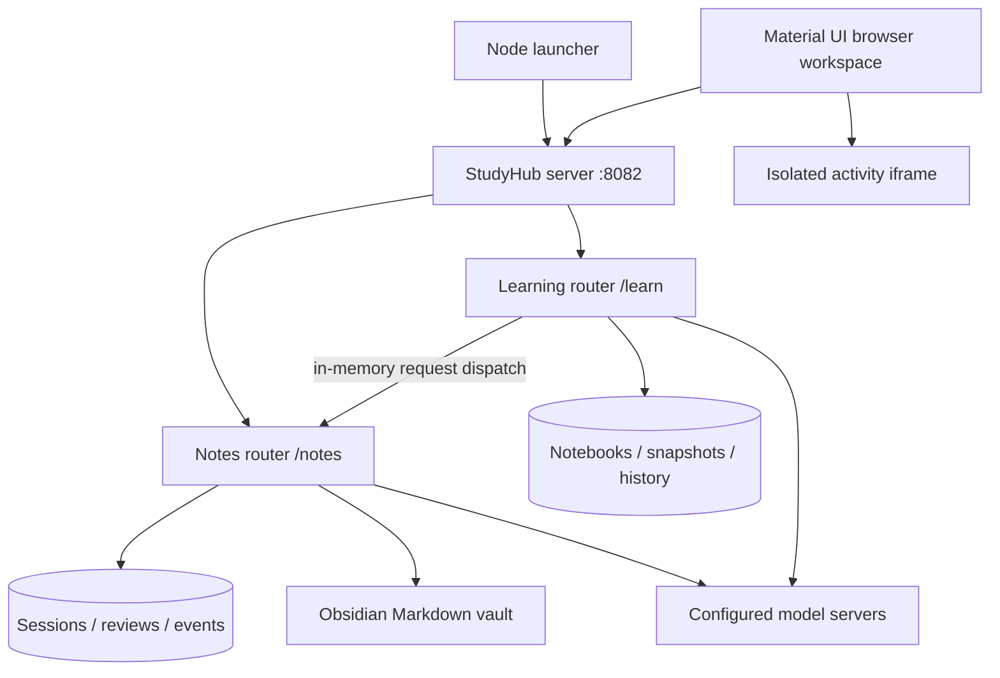

# Architecture

StudyHub is one application with three source modules. `node server.mjs` compiles and launches one native `study-hub` server. The notes and learning crates are libraries linked into that executable, not independent servers. There is one Tokio runtime, one listener, one authentication boundary and no proxy/supervisor layer. Historical `apps/` names remain to keep feature code easy to locate.

## Entry points

| File | Responsibility |
| --- | --- |
| `server.mjs` | Flags, absolute data paths, Cargo build, one binary launch, signal forwarding and exit status. |
| `apps/StudyHub/src/main.rs` | Initialize both libraries, nest routes, inject frontend base paths, authenticate every route, serve one listener and handle shutdown. |
| `apps/StudyHub/web/index.html` | Unified navigation, persistent mounted frames, notifications, source-reference return navigation and tutorial entry. |
| `src/lib.rs` | Notes settings/schema, author/vision calls, processing, vault indexes, upload/retry/kill and notes router initialization. |
| `src/review.rs` | Durable human review, original sources, edit diffs and learned corrections. |
| `src/integration.rs` | Approved-note export, recorded vault locations, host folder browser and vault/style configuration. |
| `src/note_preferences.rs` | Per-note style and default fallback. |
| `web/index.html` | Notes upload/tree/search/review/settings UI and Markdown renderer. |
| `apps/SelfHosted-AI_Tests/src/lib.rs` | Learning schema, sources/notebooks, profiles, internal notes transport and router. |
| `…/src/providers.rs` | Provider protocols, structured requests, credentials and model responses. |
| `…/src/study.rs` | Chat/tool loop, generation jobs, attempts, scoring, timers, sharing and source snapshots. |
| `…/src/learning.rs` | Step practice, evidence validation, correction workflow, mastery, journal and section reveal. |
| `…/src/runtime.rs` | Scoped incremental logs, safe provider errors and cancellation observation. |
| `…/src/history.rs` | Transactional history deletion and active-work protections. |
| `…/src/web_source.rs` | Bounded public-page fetch, address restrictions and DNS pinning. |
| `apps/SelfHosted-AI_Tests/web/index.html` | Learning screens, rich inputs, attempts, artifacts, tutorial, history and sandbox UI. |

The library `create_router` functions initialize each module once. Learn receives a clone of the Notes router and dispatches integration requests using Tower `oneshot`. It retains structured HTTP responses without opening sockets, exposing internal ports, or duplicating notes business logic. The optional export token is attached internally. Browser authentication still applies to every public route.

## Processing and source ownership

1. Notes imports original bytes, transcribes where necessary, infers missing filing metadata and creates a draft with one configured author. There is no moderator model.
2. The durable review workflow stops before final approval. Human revisions are saved independently from the AI draft; approval writes Markdown and a correction lesson. Explicit bulk requests can opt into Skip human intervention: clarification prompts return skip immediately and generated notes publish automatically, logging a system bulk save rather than a human approval. They never create human correction lessons. The per-session import option persists for retries and is reset when submitting normal appended pages.
3. `BigIdeas.md` indexes link to approved note files. A note location is recorded so changing the default vault does not break earlier imports.
4. Learn exports the approved body, excluding the automatically appended transcript callout. A replacement draft does not overwrite the approved source used for learning.
5. Notebooks retain source bodies, version fingerprints, original-file descriptors and independent teach/quiz flags. New work refreshes approved imports by default. Old conversations retain their source snapshots.
6. Tutor/tool reads are bounded to the selected context. New applied examples may vary numbers, but validation rejects known unsupported methods. This is a structural guard, not a proof of semantic correctness.

## Generation, attempts and recovery

Background jobs record request, status, progress, artifact and error. Guided practice batches one concrete problem at a time; other long materials batch up to ten items. Deterministic schema/source validation retries the same model, bounded to three attempts per generation batch. Source quotes are optional; unverified optional quotes are omitted instead of rejecting otherwise usable content. Ambiguous references still require repair. Valid earlier batches are retained when later batches fail.

Cancellation drops the pending generation future and atomically prevents late publication. A result already committed remains available. Retry creates a new job; it does not resurrect a cancelled worker. At startup, interrupted jobs/sessions become failed or retryable with recovery messages rather than silently restarting model calls.

Attempts hide answer keys until the relevant submission/completion. Multiple-choice grading and test deadlines are server-owned; written work uses the configured model. Each retake and artifact revision has an independent identity. Source reveals/help are tracked separately from unaided mastery evidence. Problem journal notes are available for every problem, not only mistakes. Corrections preserve the original artifact and avoid counting an AI mistake as a learner weakness.

## Storage

Notes and Learn retain separate SQLite files and module-owned state inside one application. They do not mutate one another's database. Notes owns reviews and approved Markdown; Learn owns imported snapshots, conversations, attempts and progress. See [configuration](CONFIGURATION.md) for exact paths and backup/reset instructions. SQLite tables and request types are indexed in the [API reference](API.md).

Persistent browser state includes notification inbox, processing observations, current notebook/job, tutorial progress and warning dismissal. The server's data epoch resets these app-owned keys after a full data reset, preventing stale IDs/inbox entries on a clean installation. It is not a login/session mechanism.

## UI and rendering

The unified shell keeps the notes and learning frames mounted while navigating, preserving drafts and running-session UI. Same-origin `postMessage` handoffs validate the expected frame, origin, message type and IDs. Citation references identify source and numbered Markdown section, resolve to a heading and open/highlight that part of the note. Back navigation restores the learning frame.

Frontend HTML is compiled into the binary. Response middleware injects `/notes` or `/learn` as the API base. All browser API requests use the one server origin. React, Material UI, Babel, Marked, DOMPurify, KaTeX and Mermaid currently load from pinned CDN URLs. Markdown is sanitized, math is normalized, literal code is protected, and Mermaid rendering is serialized. Browser text inputs preserve raw Markdown while displaying formatting, including simple powers. Enter submits; Shift+Enter adds a newline; composition input is respected.

Warning/error banners vertically center the icon, message and controls with equal vertical padding. Notification Snackbars retain a native transition child to avoid MUI Grow ref crashes. The inbox keeps the latest 100 events; visible-page polling detects note review/save/failure and study completion/failure. Optional native notifications do not run while the page is closed.

## Model tools and generated UI

Models return validated JSON tool envelopes. Supported tools include `read_source`, `search_sources`, `read_artifact`, `create_artifact`, `create_canvas`, and `update_canvas`. Unknown tools return observations. There is no model shell, unrestricted filesystem tool or arbitrary network tool.

Canvas artifacts store HTML/CSS/JavaScript; the server never executes that code. The browser runs it in an opaque-origin `allow-scripts` iframe with a restrictive CSP and no same-origin permission. `Study.state` and `Study.saveState(object)` bridge bounded activity state through a per-frame channel. The host checks frame/channel identity. Runtime errors are visible and offer repair; ordinary practice uses native attempt controls rather than generated quiz code. Generated code and explanations still need human judgment.

## Scope

This is a single-user trusted workspace. Authentication is optional HTTP Basic on the whole router; there are no tenants, roles, per-user data boundaries or background push delivery. See [operations](CONFIGURATION.md), [development](DEVELOPMENT.md), [study workflow details](LEARNING_WORKFLOWS.md), and [feature coverage](../apps/SelfHosted-AI_Tests/FEATURES.md). The prior separate-server deployment and sibling installer have been removed.

## Shared subject concepts

`src/big_ideas.rs` now owns filesystem-backed subject indexes and generated concept pages. Root `BigIdeas.md` links to `<subject>/BigIdeas.md`, which links to `<subject>/Big Ideas/<normalized idea>.md`. Each concept page collects source H2 section bodies across courses and links back using full vault paths and exact source headings. Note files receive an idempotent managed backlink block; integration exports exclude this navigation block from learning content. Fenced sample headings and navigation headings are excluded.

Idea matching normalizes case and whitespace only. Distinct wording requires the author/human to choose the shared heading, avoiding unverified semantic merges. Filename sanitization collisions receive deterministic hash suffixes. Rebuilds remove stale generated pages while retaining handwritten files. The old DB registry is retained for compatibility; both author prompt context and the visible catalog use the actual generated source-backed pages.

`GET /notes/api/vault/document?path=…` resolves Markdown within the configured vault. Traversal and symlink escapes are rejected. Qualified links disambiguate repeated note titles; bare ambiguous titles fail clearly. The frontend opens these files in a navigable dialog and highlights referenced headings. Compatibility course indexes remain available.

Bulk upload requests may provide `class_type` and `course_name` independently. The server preserves supplied values even if model metadata disagrees, infers missing filing fields, and always infers each bulk file’s lesson. A migrated `import_options.bulk_upload` flag retains bulk behavior when both fields are provided and when retrying a session.
